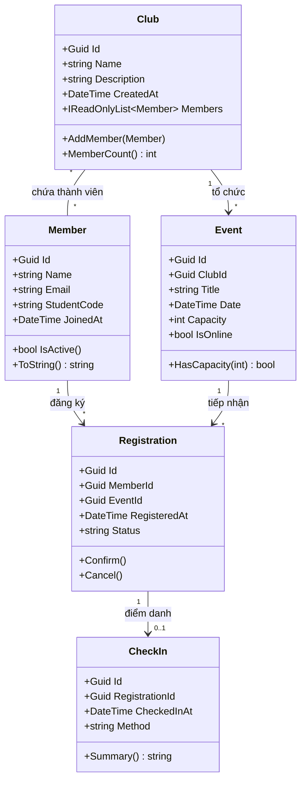

# Chương 1 — Phân Tích Yêu Cầu và Domain Modeling EduHub

> **Học phần:** IN4211 — Phát triển phần mềm hướng đối tượng  
> **Giảng viên hướng dẫn:** ThS. Nguyễn Tuấn Kiệt  
> **Sinh viên thực hiện:** Nguyễn Huỳnh Phúc Thịnh  
> **Mã số sinh viên:** `0024417329`  
> **Đánh giá:** Hoạt động HĐ 1.3 (Bài tập chương 1) — Chuẩn đầu ra: CLO1, CLO4, CLO5  

---

## 📌 1. Giới thiệu bài tập

Dự án **EduHub** là hệ thống quản lý câu lạc bộ và sự kiện sinh viên. Bài tập Chương 1 tập trung vào việc mô hình hóa miền bài toán (Domain Modeling) theo tư duy hướng đối tượng hiện đại và các nguyên tắc thiết kế sạch (Clean OOP):

* **Tính đóng gói (Encapsulation):** Toàn bộ thuộc tính sử dụng `private set`, constructor để `private` ngăn chặn việc khởi tạo tùy tiện từ bên ngoài.
* **Mẫu khởi tạo Factory Method:** Sử dụng phương thức tĩnh `Create(...)` kiểm tra chặt chẽ tính hợp lệ (Validation) ngay từ cổng vào, đảm bảo không bao giờ tồn tại thực thể ở trạng thái lỗi.
* **Bảo vệ bất biến (Invariants):** Danh sách thành viên trong `Club` được bao bọc dưới dạng `IReadOnlyList<Member>`, chỉ có thể thêm mới thông qua phương thức nghiệp vụ `AddMember(...)` để chống trùng lặp.
* **Máy trạng thái (State Machine):** Phiếu đăng ký `Registration` kiểm soát luồng trạng thái chặt chẽ: `Pending` -> `Confirmed` -> `Cancelled` (trạng thái hủy là cuối cùng, không thể kích hoạt lại).
* **Quy tắc điểm danh:** Thực thể `CheckIn` chỉ cho phép tạo khi phiếu đăng ký đã ở trạng thái `Confirmed`.

---

## 🏛 2. Sơ đồ lớp (Class Diagram)



---

## 📁 3. Cấu trúc thư mục Chương 1

```text
Ch01/
├── starter/                     # Dự án mã nguồn C# (.NET 10)
│   ├── Ch01.Console/
│   │   ├── Domain/              # 5 thực thể Domain (Club, Member, Event, Registration, CheckIn)
│   │   ├── Program.cs           # Kịch bản Console Demo 7 bước nghiệp vụ
│   │   └── Ch01.Console.csproj
│   └── docs/                    # Tài liệu đặc tả yêu cầu
│       ├── class-diagram.md     # Sơ đồ lớp Mermaid
│       └── user-stories.md      # Đặc tả User Stories
├── User Story.docx              # Bản tài liệu nộp User Story hoàn chỉnh
└── README.md                    # Tài liệu hướng dẫn chi tiết Chương 1
```

---

## 🚀 4. Hướng dẫn chạy chương trình

Tại thư mục gốc của dự án, mở Terminal và chạy lệnh:

```bash
dotnet run --project Ch01/starter/Ch01.Console/Ch01.Console.csproj
```

---

## 📊 5. Kết quả thực thi thực tế (Console Output)

Chương trình thực hiện tuần tự và hoàn thành đầy đủ luồng demo nghiệp vụ:

```text
=== EduHub — Club & Event Management ===

CLB vừa tạo: Tech Club — Câu lạc bộ công nghệ: workshop, hackathon, chia sẻ kiến thức.
+ Đã thêm: Nguyễn Văn An DH24001
+ Đã thêm: Trần Thị Bình DH24002
+ Đã thêm: Lê Hoàng Cường DH24003
Tổng số thành viên trong CLB: 3

Sự kiện: Workshop AI — Ngày: 02/11/2026 14:00 — Sức chứa: 50
Nguyễn Văn An đăng ký thành công -> Trạng thái: Pending
Trần Thị Bình đăng ký thành công -> Trạng thái: Pending
Xác nhận phiếu cb43f3d0 -> Trạng thái mới: Confirmed
Xác nhận phiếu f78cc2c8 -> Trạng thái mới: Confirmed

Check-in 16:52:57 qua QrCode (phiếu cb43f3d0)

--- BÁO CÁO THAM DỰ SỰ KIỆN ---
Số lượng đăng ký: 2/50
Số lượng đã check-in: 1
- Nguyễn Văn An: ĐÃ CHECK-IN
- Trần Thị Bình: CHƯA CHECK-IN

✅ Demo complete!
```
